# Videojuego 2D: el recolector

Hiram Agustín Acevedo López · Licenciatura en Desarrollo de Sistemas Web

Proyecto de Unity de la unidad 3 de Optativa Abierta III. Un recolector de basura recorre la calle detrás del camión; cada entrega de la unidad agrega una parte del juego sobre este mismo proyecto.

## Abrir el proyecto

1. Clona el repositorio.
2. En Unity Hub, entra a Projects > Add > Add project from disk y elige la carpeta clonada (la que contiene `Assets`, `Packages` y `ProjectSettings`).
3. Ábrelo con Unity 6000.5.9f1. Usa la plantilla Universal 2D (URP) y el Input System. La primera importación genera `Library` y tarda unos minutos.
4. Abre `Assets/Scenes/Calle.unity`, la escena principal y la primera de Build Settings, y presiona Play.

## Teclas

| Tecla | Qué hace |
|---|---|
| Flecha derecha o D | Se desplaza a la derecha corriendo, mirando a la derecha (desde la entrega 3.5) |
| Flecha izquierda o A | Se desplaza a la izquierda corriendo, mirando a la izquierda (desde la entrega 3.5) |
| Ninguna, o las dos direcciones a la vez | Se detiene, en Reposo, mirando hacia la última dirección |
| Barra espaciadora, W o flecha arriba | Salta con los pies en el suelo y, en el aire, una vez más: el doble salto (un salto por pulsación; la barra espaciadora, desde la entrega 3.6; con V sostenida, sólo la barra) |
| V (sostenida) | Carga la bolsa sin dejar de correr: aparece la mira y se llena la barra de fuerza; las flechas arriba y abajo, o W y S, suben y bajan la mira (desde la entrega 3.6) |
| V (al soltar) | Lanza la bolsa hacia la mira con la fuerza de la barra: en la franja verde, tiro perfecto; en el tramo rojo se rompe en la mano, y si se queda en rojo revienta y quita un corazón |
| F (sostenida) | Ráfaga de botellas sin dejar de correr ni de saltar: una cada 0.25 segundos, rectas hacia donde mira, que se rompen en vidrios a 7.5 unidades o al chocar (desde la entrega 3.7; en la 3.6, F era el swing) |

## La escena y el personaje (entrega 3.1)

- `Main Camera`: cámara ortográfica con Pixel Perfect Camera (URP 2D), 96 píxeles por unidad y resolución de referencia 1920x1080 (desde la entrega 3.2; antes 32 y 640x360). La vista mide 20 por 11.25 unidades: el escenario, a 32 píxeles por unidad, se dibuja a 3 píxeles de pantalla por píxel y el recolector y los proyectiles, a 48, a 2, los dos enteros. Encuadra las fachadas, la banqueta y un poco de asfalto. Desde la entrega 3.4 lleva además el script `CamaraSigue`.
- `Grid > Suelo`: Tilemap de la banqueta y el asfalto, con la paleta `Assets/Arte/Paleta/Calle.prefab` (Window > 2D > Tile Palette).
- `Calle`: el script `CalleModular` encadena las fachadas de `Assets/Arte/Escenario/Modulos/` en orden aleatorio con semilla fija, pinta el suelo y repite el cielo hasta cubrir lo que ve la cámara más un margen; lo que queda atrás se recicla. Con la cámara quieta sólo llena la vista; desde la entrega 3.4 la cámara sigue al recolector y la calle avanza con ella.
- `Recolector`: SpriteRenderer, Animator y `RecolectorControl`, de pie sobre la banqueta (desde la entrega 3.3, también Rigidbody2D y CapsuleCollider2D).

Los sprites del recolector salen de tiras de cuadros del mismo tamaño (`Assets/Arte/Recolector/`), cortadas en modo Multiple con el pivote en los pies y filtro Point. El controlador `Assets/Animaciones/Recolector.controller` tiene dos estados: Reposo (por defecto) y Correr, con transiciones en ambos sentidos sin Has Exit Time y el parámetro bool `corriendo` (desde la entrega 3.6 el cuerpo va en dos partes y una segunda capa, Brazos, tiene Cargar y Lanzar).

`Assets/Scripts/RecolectorControl.cs` lee el teclado con el Input System (`Keyboard.current`), pone `corriendo` en verdadero mientras hay una dirección pulsada y voltea al personaje con la escala en x. Desde la entrega 3.5 esa misma dirección mueve al cuerpo.

El personaje cambia de animación y de orientación según la tecla, lanza la bolsa y la botella (entrega 3.2), salta con la física 2D (entrega 3.3) y da el doble salto desde la 3.4; la cámara lo sigue desde la entrega 3.4 y se desplaza por la calle desde la 3.5.

## Los prefabs (entrega 3.2)

Las balas de este juego son dos prefabs que salen de la misma base, el script `Proyectil`: la bolsa de basura, que se lanza apuntando, y la botella, el proyectil rápido. Los dos nacen en la mano del recolector, no en el centro del personaje, y salen hacia donde está mirando.

Las dos imágenes juntan varios cuadros del mismo lanzamiento: el arco de la bolsa con la mira alta y la línea recta de la botella. La de la bolsa es de la 3.2, antes del collider del suelo; su rebote está en la sección de la 3.3.

- `Assets/Scripts/Proyectil.cs`: la base común. Cada prefab trae su configuración (rapidez, escala de gravedad, vida, giro y cuántos contactos aguanta); `Lanzar(direccion, sentido)` fija la velocidad inicial y la velocidad angular del Rigidbody2D, y la física 2D hace el resto. El proyectil desaparece al salir del encuadre de la cámara o al cumplir su vida. Otro objeto que vuele es un prefab nuevo con otros números.
- `Assets/Prefabs/Bolsa.prefab`: sprite `bolsa.png` (24x24), Rigidbody2D con gravedad, CircleCollider2D (radio 0.19) con el material `Assets/Fisica/Bolsa.physicsMaterial2D` (restitución 0.5, fricción 0.4) y `Proyectil` a 7 unidades por segundo con giro de 200 grados por segundo. Se lanza como en Yoshi's Island: al sostener K aparece la mira (`Mira.cs`, hija del recolector), que oscila sola entre -10 y 70 grados delante de él, a 2.5 unidades de la mano, en ciclos de 1.2 segundos; al soltar K la bolsa sale hacia la mira y la gravedad la curva (desde la 3.6 se carga con V y la mira se mueve a mano). Con la mira alta sube por encima de la cabeza y cae unas cuatro unidades adelante; con la mira baja es un tiro corto y tendido. En la 3.2 el suelo todavía no tenía collider, así que la bolsa atravesaba la banqueta, seguía cayendo y desaparecía al salir de la vista; conservó su collider, su material y dos rebotes configurados, y desde la 3.3 rebota en el suelo.
- `Assets/Prefabs/Botella.prefab`: sprite `botella.png` (12x24), Rigidbody2D sin gravedad (escala 0), CapsuleCollider2D y `Proyectil` a 14 unidades por segundo girando a 540 grados por segundo. Sale con la barra espaciadora (en la 3.6, con el swing de F; desde la 3.7, en ráfaga con F sostenida), recta y horizontal hacia donde mira el recolector, y desaparece al salir de la vista o a los 3 segundos (desde la 3.7 se rompe a 7.5 unidades). Es la plantilla de cualquier otro proyectil rápido.
- `PuntoDisparo`: un objeto vacío, hijo del `Recolector`, a la altura de la mano (0.75 unidades por delante del centro y 0.9 sobre los pies; desde la 3.6, en la mano abierta del cuadro de soltar, a 0.51 y 1.34); los dos proyectiles nacen ahí. Como es hijo, cuando el personaje se voltea con la escala en x el punto y la mira pasan al otro lado.
- `RecolectorControl.cs`: lee las dos teclas con el Input System (`wasPressedThisFrame` y `wasReleasedThisFrame`: un proyectil por pulsación), instancia el prefab en `PuntoDisparo` y le pasa la dirección: la de la mira para la bolsa, la horizontal hacia donde mira para la botella. Los proyectiles no chocan con el recolector ni entre sí (`Physics2D.IgnoreCollision`).

La animación de lanzar llegó en la 3.6; la cadencia del lanzamiento y los efectos de acción, en la 3.7. El collider del suelo y la física del recolector (gravedad, salto, colisiones) llegaron en la 3.3.

## Mecánicas y físicas (entrega 3.3)

El recolector ya tiene cuerpo físico: la gravedad lo baja, choca con la banqueta y salta con W o con la flecha arriba. El suelo tiene collider, así que la bolsa, que en la 3.2 atravesaba la banqueta, ahora rebota en ella.

Cada cuadro lleva el tiempo desde que se presiona W y la altura de los pies. Con la flecha arriba el salto es el mismo.

- `Recolector`: Rigidbody2D dinámico (masa 1, escala de gravedad 1, rotación en Z congelada, interpolado y con detección continua) y CapsuleCollider2D vertical de 0.75 por 2.19 unidades, ajustada al cuerpo sin los brazos y con la base en los pies (y = 0).
- `Grid > Suelo`: TilemapCollider2D unido (Merge) en un CompositeCollider2D, con un Rigidbody2D estático, en la capa `Suelo` (capa de usuario 6). Los tiles usan el collider de la celda completa y el compuesto baja 0.375 unidades (12 píxeles del suelo) para que la superficie quede en la línea de los pies. Como `CalleModular` pinta el suelo conforme avanza la calle, el collider crece con ella.
- `RecolectorControl.cs`: en cada cuadro lanza un rayo hacia abajo (`Physics2D.Raycast`) desde el centro de la cápsula hasta 0.1 unidades por debajo de los pies, sólo contra la capa `Suelo`, para saber si está en el suelo; `Debug.DrawRay` lo dibuja en la vista de escena. Con W o la flecha arriba (`wasPressedThisFrame`) y los pies en el suelo, salta con `AddForce` hacia arriba en modo impulso: sale a 5 unidades por segundo, sube 1.22 unidades y vuelve a la banqueta en 1.02 segundos. En el aire, otra pulsación no hace nada.
- La bolsa rebota en la banqueta con su material (restitución 0.5), cada vez más bajo, y desaparece al tercer contacto; la botella vuela recta por encima del suelo. Ninguna de las dos choca con el recolector (`Physics2D.IgnoreCollision` con su cápsula).

La cámara que sigue al recolector llegó en la 3.4 y el desplazamiento a los lados, en la 3.5.

## La cámara (entrega 3.4)

La cámara sigue al recolector como en el tutorial (34:07): en cada cuadro toma su posición en x. En y lo deja subir hasta 1.3 unidades sin moverse, un poco más de lo que alcanza un salto (1.22), así que con el salto sencillo se queda quieta y el recolector sube en la pantalla. Con el doble salto, W o la flecha arriba otra vez en el aire, pasa de esa altura: la cámara sube con él y al aterrizar regresa a su altura de la escena. Con el recolector quieto la vista es la de la entrega 3.3, píxel por píxel. Moverse a los lados con el teclado llegó en la 3.5; en esta entrega el seguimiento en x se probó dándole velocidad al cuerpo del recolector desde código.

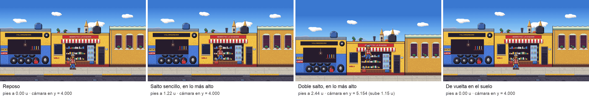

- `Assets/Scripts/CamaraSigue.cs`: el script de cámara del tutorial (34:07), con el recolector en lugar de John. En cada cuadro pone la x de la cámara igual a la de su objetivo. La y se queda en la de la escena mientras el recolector no suba más de `alturaLibre` (1.3 unidades, en el Inspector); arriba de eso la cámara va a la misma distancia de él, redondeada a píxeles enteros (259 px), y nunca baja de su altura de la escena. La z no se toca. Corre en `LateUpdate` y antes que `CalleModular` (el tutorial usa `Update`): así lee la posición del recolector ya interpolada en ese cuadro y la calle se arma con ella. Si el objetivo desaparece (46:40), la cámara se queda donde está.
- `Main Camera`: sigue la Pixel Perfect Camera de la 3.2 (96 píxeles por unidad, referencia 1920x1080), que fija el tamaño (1080 / 2 / 96 = 5.625): una vista de 20 por 11.25 unidades donde el recolector ocupa el 19 % de la altura y, con su salto, el 30 %. El tutorial baja `Size` a mano (8:07); aquí no se toca, y la última figura compara esta distancia con una al doble y otra a la mitad.
- Sin retraso: en un recorrido de x = -29.5 a x = 29.5 y de regreso a 4.9 unidades por segundo (1 920 cuadros), la cámara tuvo la x del recolector en todos los cuadros, también al detenerse y a 30, 60 y 144 cuadros por segundo.
- Sin temblor: la Pixel Perfect Camera dibuja la cámara y cada sprite en el píxel más cercano a su posición; con la misma x caen en el mismo y el recolector no se mueve en la pantalla (su columna en la imagen no cambió ni una vez en los 720 cuadros que mide la prueba, a ocho velocidades y en los dos sentidos). Cuando lo sigue en y, la distancia entre los dos es un número entero de píxeles en cada cuadro, así que pasa lo mismo.
- `Assets/Scripts/RecolectorControl.cs`: el doble salto. Con W o la flecha arriba en el aire salta una vez más (`saltosEnElAire` = 1) y al tocar el suelo se recarga; un tercer toque en el aire ya no salta. El segundo salto parte de velocidad vertical cero, como el primero, así que sube lo mismo: en la prueba los dos juntos suben 2.44 unidades, la cámara sube 1.14 (110 px) y en lo más alto quedan 0.49 unidades de suelo a la vista.
- `Calle`: `CalleModular` ya leía la posición de la cámara. En ese recorrido la vista tuvo fachadas, suelo y cielo en todos los cuadros, la calle no pasó de 7 piezas de fachada ni de 6 columnas de suelo, y al volver están las mismas fachadas en el mismo lugar. La botella sigue desapareciendo al salir de la vista (con la cámara en x = 24, a 10.8 unidades de ella).

Al doble de distancia el recolector se pierde bajo un cielo vacío y la calle queda en una franja; a la mitad no cabe ni una fachada entera y su salto ocupa más de la mitad de la altura.

## El movimiento del jugador (entrega 3.5)

El recolector se desplaza por la calle con las flechas izquierda y derecha, o con A y D, como en el tutorial (11:53 a 15:23): en cada paso de la física la velocidad en x de su Rigidbody2D es el eje horizontal (-1, 0 o 1) por una rapidez de 4 unidades por segundo, y la velocidad en y se deja a la gravedad y al salto. Arranca y se detiene al instante, mira hacia donde va y corre con la animación de la 3.1; al soltar la tecla queda en Reposo. El salto, el doble salto, la mira, la bolsa y la botella siguen igual, y la cámara copia su x en cada cuadro.

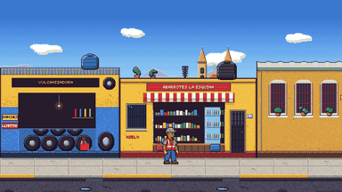

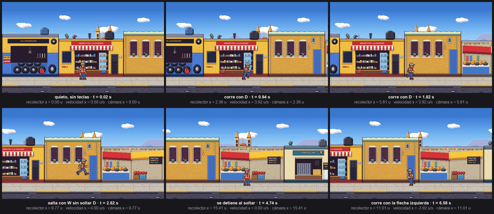

- `Assets/Scripts/RecolectorControl.cs`: un campo nuevo, `velocidad` (4 unidades por segundo, en el Inspector), y `FixedUpdate`, que pone `cuerpo.linearVelocity = new Vector2(Horizontal * velocidad, cuerpo.linearVelocity.y)`. `Horizontal` es el eje que el script ya leía en `Update` con el Input System desde la 3.1 (las flechas o A y D: -1, 0 o 1, como `Input.GetAxisRaw("Horizontal")` en el tutorial); la física se toca en `FixedUpdate` y no en `Update`, como explica el tutorial (13:49). El Rigidbody2D tiene la rotación congelada desde la 3.3, así que el recolector no se vuelca al avanzar (15:09).
- Medido con el juego en marcha y un teclado virtual: con D, con A o con cada flecha avanza 3.92 unidades por segundo (los 0.08 que faltan son la fricción de la cápsula con la banqueta en cada paso de la física; en el aire lleva los 4), sin retroceder ni un cuadro, y las flechas dan la misma velocidad que las letras. Al soltar, el cuerpo avanza 0.08 unidades más y queda en cero; con las dos direcciones a la vez no se mueve. A 30, 60 y 144 cuadros por segundo recorre lo mismo.
- Las colisiones de la 3.3 siguen: en un recorrido de 32 segundos (1 920 cuadros, de x = -23.5 a x = 23.5 y de regreso) los pies se mantuvieron en y = 0.005 en todos los cuadros y el rayo del suelo nunca lo perdió; contra un bloque de prueba con BoxCollider2D, que no está en el juego, se detiene en su cara a 0.005 unidades sin atravesarlo, por los dos lados, y sin el bloque pasa de largo. Saltando sin soltar la tecla conserva los 4 u/s en el aire, sube 1.22 u y aterriza corriendo a 4.05 u del despegue; con el doble salto sube 2.44 u y la cámara sube con él y regresa, como en la 3.4.
- La bolsa y la botella se lanzan corriendo: la bolsa sale de la mano, rebota dos veces en la banqueta y desaparece; la botella sale a 14 u/s y desaparece al salir de la vista de la cámara, que ahora se mueve con el recolector. Al lanzar, el recolector no pierde velocidad ni el suelo.

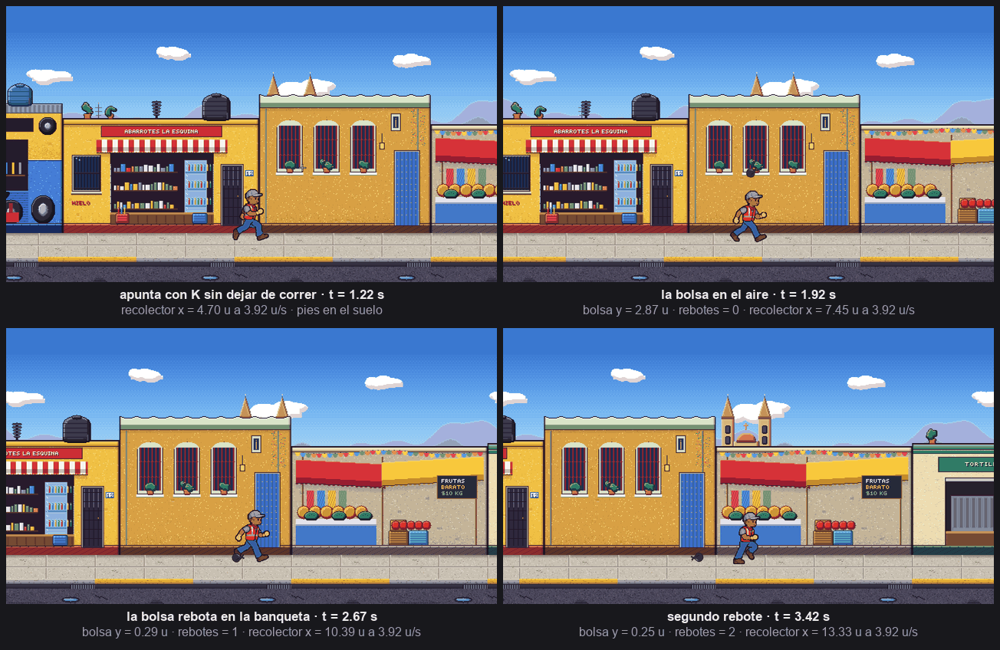

## El movimiento de una bala (entrega 3.6)

El recolector lanza la bolsa y la botella con una animación propia y sin dejar de correr, como la bala del tutorial (18:57 a 31:10): cada proyectil es un prefab con Rigidbody2D que se instancia en la mano y no en el centro del personaje (28:40), con la dirección que da el signo de la escala en x (30:00), y el Animator cambia de estado con parámetros que el script pone en el mismo cuadro de la tecla, sin Has Exit Time ni duración en las transiciones (21:40 a 23:20). Las teclas cambian: la barra espaciadora pasa al salto (W y la flecha arriba siguen saltando), la bolsa a la V y la botella a la F.

Para correr y lanzar a la vez, el recolector va en dos partes, como los personajes de Metal Slug: las piernas, en el SpriteRenderer del recolector, y el torso (cabeza, tronco y brazos), en un hijo encima. La capa base del Animator anima las dos con Reposo y Correr, las de la 3.1, y una segunda capa, Brazos, se impone al torso con dos animaciones de estado nuevas: Cargar, mientras se prepara el lanzamiento, y Lanzar, al soltar. Las piernas siguen corriendo debajo, y el torso de lanzar se monta en la cadera de cada cuadro de carrera, que sube y baja hasta 8 píxeles. Sin lanzar, Reposo y Correr se ven igual que antes: las dos partes juntas son el cuadro original, píxel por píxel.

La bolsa se lanza con fuerza. Con V sostenida, sin frenar, aparece la mira a 35 grados (las flechas arriba y abajo, o W y S, la suben o la bajan entre -10 y 70; mientras tanto sólo la barra espaciadora salta) y sobre la cabeza se llena una barra en 1.1 segundos. Al soltar V la bolsa sale con la fuerza de la barra: un toque la deja a 2.1 unidades, y la franja verde, del 80 al 95 %, es un tiro perfecto con 25 % más de fuerza y estela dorada que cae a 9.7 unidades. El tramo rojo es el riesgo: soltar ahí rompe la bolsa en la mano, y quedarse 0.45 segundos en rojo la revienta: pedazos, un corazón menos, un empujón hacia atrás y 0.4 segundos aturdido, parpadeando en rojo. Sin corazones se desmaya un segundo y se levanta con los tres.

La botella se lanza con ritmo (en la 3.7 el swing se quitó y F sostenida es una ráfaga). F arranca el swing: una aguja cruza la barra en 0.7 segundos y regresa. F otra vez la lanza según dónde esté la aguja: en el centro verde, tiro perfecto a 18.9 u/s (14 por 1.35) con estela; en amarillo, normal a 14 u/s; en rojo se le resbala y se rompe a sus pies, y si la aguja va y vuelve sin el segundo toque, también.

La animación de lanzar son ocho cuadros del torso, de 128x128, con el arco de un lanzamiento por encima del hombro: listo, anticipación y armado forman Cargar, que se queda en el armado (el codo a la altura del hombro y la mano detrás de la cabeza) mientras dura la carga o el swing; impulso, suelta, seguimiento, recuperación y regreso forman Lanzar, de 0.35 segundos, con el tronco inclinado y el otro brazo en contrapeso. La bolsa o la botella en la mano sigue al guante cuadro a cuadro, y el proyectil nace en la mano abierta del cuadro de suelta en el mismo cuadro en que se suelta la tecla.

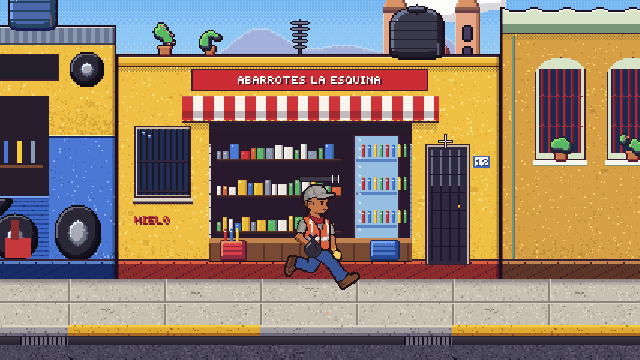

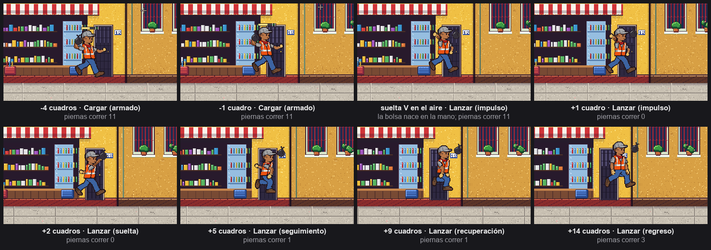

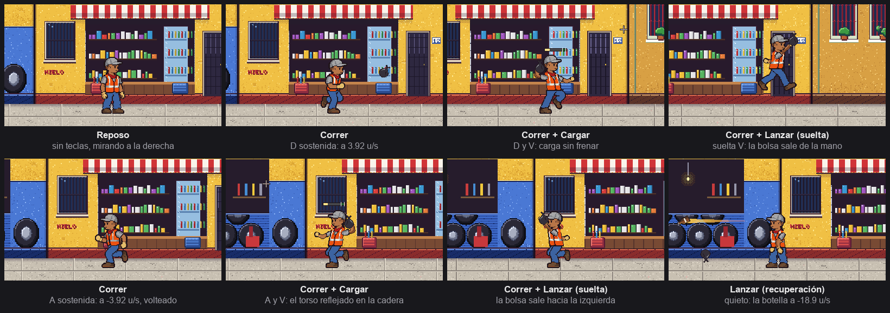

- `Assets/Scripts/RecolectorControl.cs`: el salto con la barra espaciadora; V y F; los parámetros `cargando` (`SetBool`) y `lanzar` (`SetTrigger`), puestos en el mismo cuadro de la tecla, y el peso de la capa Brazos (1 mientras carga o lanza, 0 el resto, para que el torso vuelva al de la capa base). `LateUpdate` monta el torso de lanzar en la cadera de las piernas que se ven (`cuadrosPiernas` y `caderas`) y lleva el objeto en la mano al guante del cuadro (`cuadrosMano` y `anclasMano`); `Lanzar` instancia el prefab en `PuntoDisparo`, la mano abierta del cuadro de suelta (0.57 unidades por delante y 1.80 sobre los pies), movido con el torso.
- `Assets/Scripts/MedidorCarga.cs` y `Assets/Scripts/MedidorSwing.cs` (nuevos; el segundo se quitó en la 3.7): la barra de la bolsa y la aguja de la botella, hijos del recolector y dibujados con un sprite de un píxel escalado; deciden el resultado (normal, perfecto, inútil o resbalón) y la fuerza.
- `Assets/Scripts/Salud.cs` (nuevo): tres corazones en la esquina de la vista, el golpe con empujón y aturdimiento, el parpadeo de las dos partes mientras es invulnerable y el desmayo. `Assets/Scripts/Pedazo.cs` (nuevo): los pedazos de una bolsa o una botella rota, que caen con gravedad y desaparecen.
- `Assets/Scripts/Proyectil.cs`: la fuerza multiplica la rapidez, el tiro perfecto agrega una estela (TrailRenderer), y `Resbalar` y `Romper` resuelven los lanzamientos fallidos. `Assets/Scripts/Mira.cs`: la mira se mueve a mano mientras se carga, en lugar de oscilar sola.
- `Assets/Animaciones/`: `Recolector_Reposo` y `Recolector_Correr` animan piernas y torso con los tiempos de siempre; `Recolector_Cargar` y `Recolector_Lanzar`, sólo el torso; `Recolector.controller` suma la capa Brazos (Libre, Cargar y Lanzar), con transiciones desde cualquier estado, sin tiempo de salida ni fundido.
- `Assets/Arte/Recolector/`: `reposo_piernas.png`, `reposo_torso.png`, `correr_piernas.png` y `correr_torso.png`, las tiras de la 3.1 partidas en dos (donde un guante tapaba la mezclilla, el pantalón se completó debajo); `lanzar_torso.png` (1024x128, ocho cuadros). `Assets/Arte/HUD/`: el píxel de las barras y los corazones de 9x8.

Medido con el juego en marcha y un teclado virtual, en 18 revisiones sin una falla y sin errores ni avisos en la consola: las piernas (Reposo, Correr) y el torso (Cargar, Lanzar) cambian en el mismo cuadro en que se lee la tecla; en una carga de 24 cuadros la bolsa estuvo en el guante del cuadro que se veía y el torso en la cadera, sin desvío; al soltar V, en ese mismo cuadro, la bolsa nace en la mano abierta y Lanzar pasa por sus cinco cuadros. Corriendo con D, en 94 cuadros cargando, saltando con la barra espaciadora y soltando la bolsa en el aire y la botella, las piernas estuvieron en Correr en todos, a 3.92 u/s (4 en el aire), y el torso en la cadera de los 12 cuadros de carrera; nunca se movió sin las piernas en Correr. Hacia la izquierda pasa lo mismo, reflejado. Al soltar la dirección se detiene en el mismo cuadro en las nueve combinaciones probadas (corriendo, cargando, justo después de soltar la bolsa, con el swing, en el aire, tras lanzar la botella, a la izquierda, con la flecha y con A y D a la vez): Reposo en ese cuadro, velocidad cero a más tardar en el tercero y quieto después.

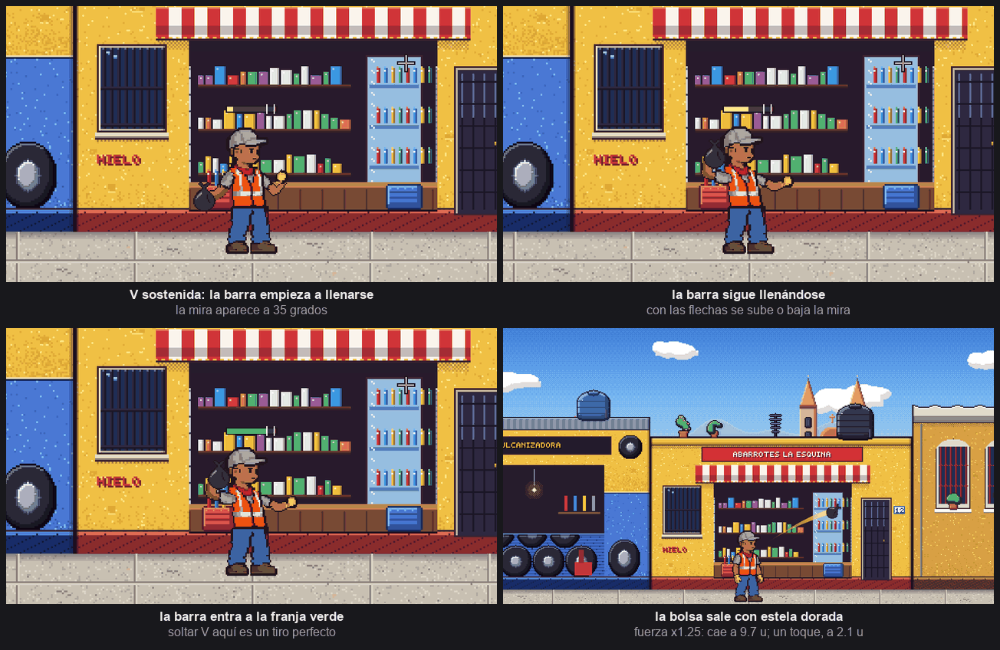

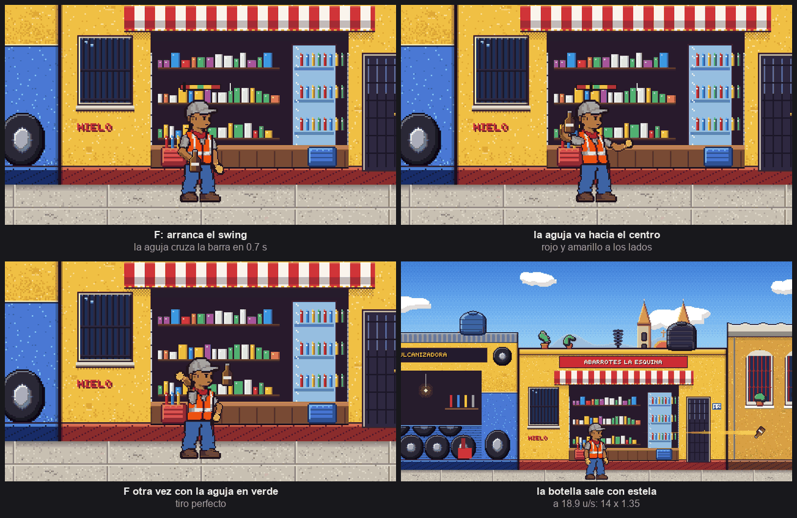

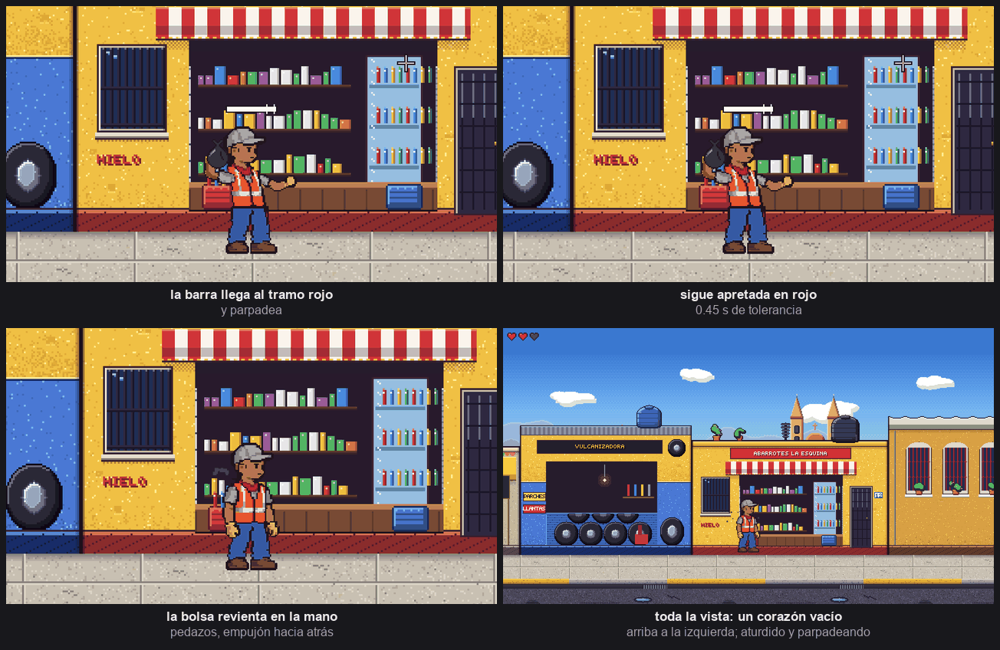

## Efectos de acción (entrega 3.7)

Con F sostenida, el recolector lanza una ráfaga de botellas, como el disparo del tutorial (25:22 a 34:07): una cada 0.25 segundos, rectas, horizontales y sin gravedad. Cada botella sale con un destello en la mano, deja una estela y se rompe en vidrios al llegar a 7.5 unidades de la mano o al chocar con algo. El swing de la 3.6 se quitó: con la tecla sostenida, un segundo toque para medir el tiro no tenía sentido. La bolsa sigue igual, con V.

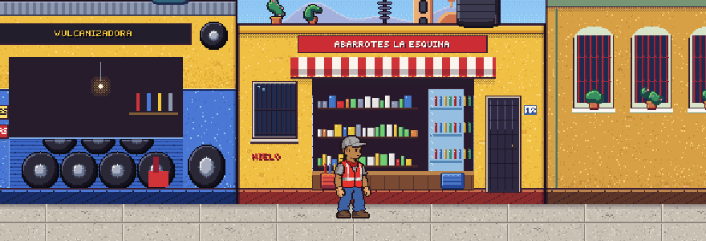

- **Sin gravedad.** El Rigidbody2D de la botella tiene escala de gravedad 0, como la bala del tutorial (27:06), sin amortiguación, y como en el tutorial (27:22) su velocidad se vuelve a poner en cada paso de la física: nada la frena ni la desvía. Saltando con F sostenida, cada botella sigue a la altura de la mano de la que salió aunque el recolector suba y baje.
- **Trayectoria lineal y constante.** Sale a 14 unidades por segundo hacia donde mira y en cada cuadro está en su recta, a 14 por el tiempo que lleva desde la mano. El Rigidbody2D va interpolado: la física da 50 pasos por segundo y el juego dibuja 60 cuadros, y sin interpolación la botella se quedaría quieta un cuadro de cada seis.
- **Cantidad uniforme y fluida, sin encimarse.** El tutorial (31:33) guarda `Time.time` del cuadro en que salió el disparo y compara con esa hora más 0.25: el retraso de ese cuadro se suma al intervalo siguiente. Aquí la cita de cada botella es la de la anterior más 0.25 exactos, así que sale una cada 15 cuadros a 60 por segundo, y si un cuadro llega un poco tarde la botella nace adelantada lo que ya habría recorrido. Quedan a la misma distancia una de otra: 3.5 unidades quieto y 2.5 corriendo, porque la mano avanza con él. Tocar F más rápido no adelanta ninguna.
- **Efectos.** El destello de la mano dura tres cuadros. La estela son copias del sprite de la botella cada 0.35 unidades, quietas donde pasó y cada vez más tenues (0.1 segundos). Al romperse, otro destello más grande y 15 pedazos de vidrio y brillo que caen; si se rompe en el aire, siguen un poco hacia donde iba. El tutorial termina la bala con un evento al final de su animación (32:17); la botella termina rompiéndose a su alcance.
- **Animación.** Rafaga es un lanzamiento corto del torso para cada botella, en 0.25 segundos: suelta, seguimiento, armado e impulso, con la botella siguiente en la mano en el armado y el impulso. Al soltar F, RafagaFin baja el brazo y el torso vuelve al de la capa base. Las piernas siguen en Reposo o en Correr.

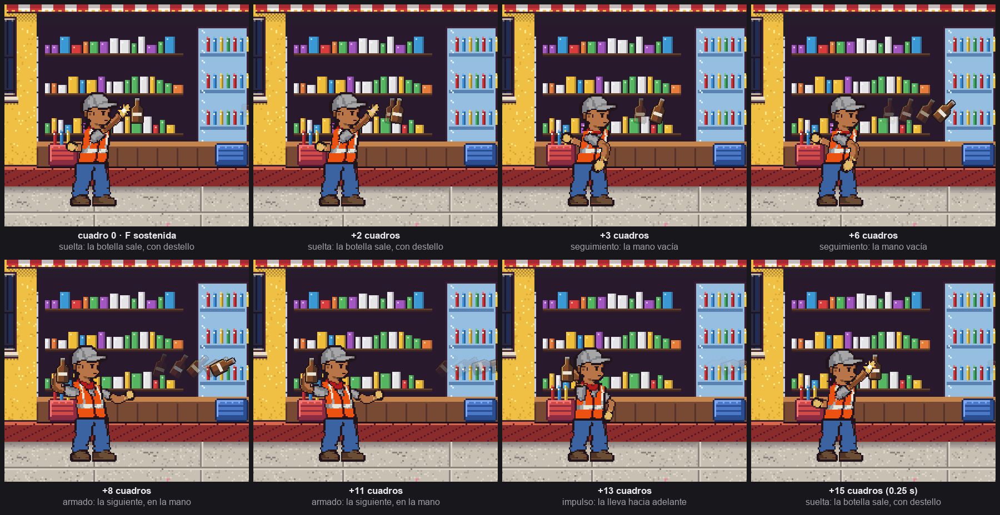

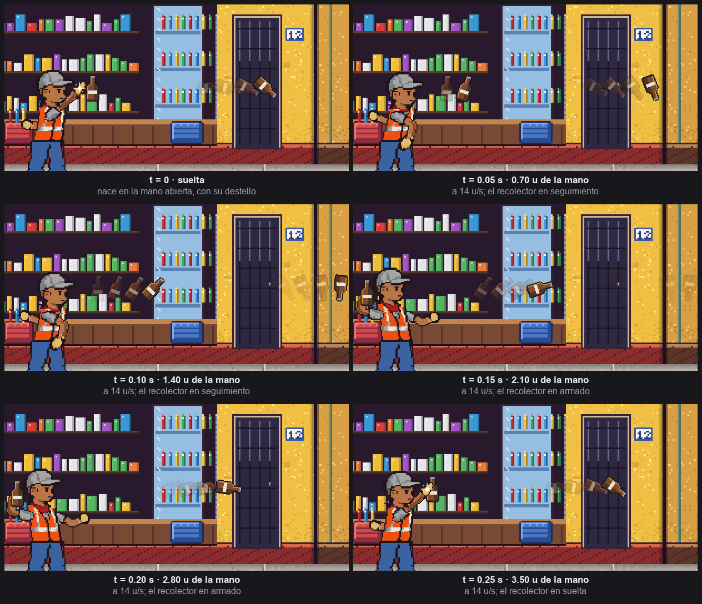

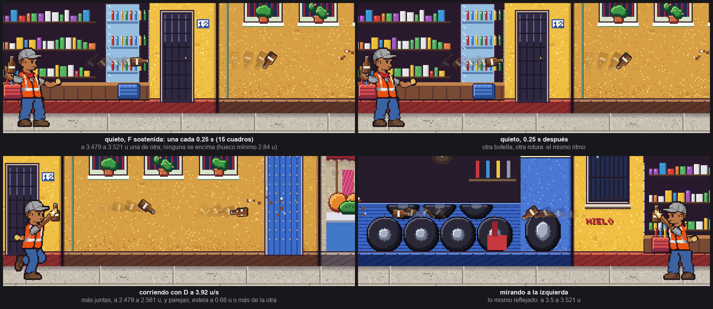

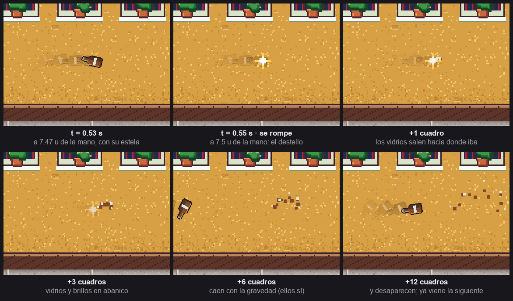

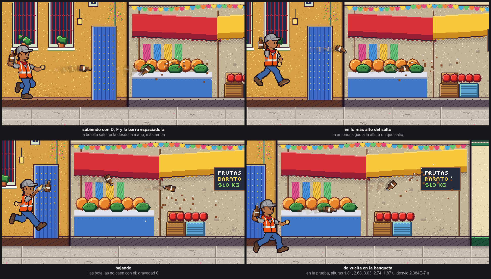

- `Assets/Scripts/RecolectorControl.cs`: F sostenida en lugar del swing. La cita de la siguiente botella avanza 0.25 exactos; en el cuadro de cada una, `Animator.Play` reinicia Rafaga en la capa Brazos, la botella nace en la mano abierta y aparece el destello. Al soltar F, RafagaFin. Un golpe corta la ráfaga y, para seguir, hay que volver a tocar F. Mientras se carga la bolsa, F no lanza, y en la ráfaga V no carga.
- `Assets/Scripts/Proyectil.cs`: `Disparar`, para la botella de la ráfaga, con su cita; el alcance, la rotura al chocar, la velocidad puesta en cada paso de la física, la estela de copias y la rotura con brillos y destello. Lo de la bolsa no cambia.
- `Assets/Scripts/Desvanecer.cs` (nuevo): un sprite que se desvanece; son las copias de la estela y los destellos. `Assets/Scripts/Pedazo.cs`: el tamaño de los pedazos y el empuje con que salen.
- `Assets/Scripts/MedidorSwing.cs`: se quitó, y con él el hijo `MedidorSwing` del recolector.
- `Assets/Animaciones/`: `Recolector_Rafaga` y `Recolector_RafagaFin` (nuevos), con los cuadros del torso de lanzar de la 3.6; `Recolector.controller` suma Rafaga y RafagaFin a la capa Brazos, sin escribir valores por omisión, y RafagaFin vuelve a Libre al terminar.
- `Assets/Prefabs/Botella.prefab`: alcance 7.5, se rompe al chocar, velocidad constante, estela cada 0.35 unidades, 10 pedazos de vidrio de 3 y 4 píxeles y 5 brillos, destello al doble y Rigidbody2D interpolado. `Assets/Arte/Props/destello.png` (nuevo).

Medido con el juego en marcha y un teclado virtual, en 27 revisiones sin una falla y sin errores ni avisos en la consola:

- Con F sostenida 2 segundos salen 8 botellas, la primera en el cuadro de la tecla y las demás cada 15 cuadros, con citas cada 0.25 segundos exactos. A 30, 50 y 144 cuadros por segundo también salen 8 en 2 segundos (cada 7 u 8, 12 o 13 y 36 cuadros) y quedan a la misma distancia.
- Escala de gravedad 0 en las 264 muestras de vuelo (botella por cuadro), sin cambio de altura ni velocidad vertical. Saltando, cinco botellas a cinco alturas, cada una en la suya.
- En cada cuadro de vuelo, velocidad (14, 0) y la posición en su recta, x = mano + 14(t - cita), sin desvío medible. A 60 cuadros por segundo, en el cuadro en que nace la botella está a lo más 0.28 unidades delante de la mano abierta: lo que avanza en un paso de la física.
- Entre botellas seguidas, de 3.479 a 3.521 unidades quieto y de 2.478 a 2.561 corriendo: la mano sube y baja con la cadera del cuadro de piernas (un píxel al respirar en Reposo, hasta dos en Correr). Ninguna caja de botella se tocó con otra (hueco mínimo 2.84 unidades) ni una estela con otra botella (0.66 corriendo).
- Las 8 se rompieron a 7.5 unidades de la mano, en su recta, a 1.93 unidades o más del borde de la vista, cada una con 15 pedazos y su destello. Contra un bloque de prueba con BoxCollider2D, que no está en el juego, se rompen en su cara y ninguna lo atraviesa.
- Con 30 toques de F en 2 segundos salen 8, cada 16 cuadros: nunca antes de los 15 de la cadencia.
- Al soltar F, RafagaFin en ese cuadro y Libre al terminar; no sale ninguna botella más. Un golpe corta la ráfaga en el cuadro siguiente y, aturdido o con F todavía sostenida, no sale ninguna. Con V cargando, F no lanza; la bolsa sale con su arco.

## Arte

Todo el arte es original y está hecho para este proyecto. El recolector es pixel art de 128x128 por cuadro, editado en Aseprite: 8 cuadros de reposo y 12 de carrera, con los pies en la misma línea en todos los cuadros (desde la 3.6, partidos en piernas y torso), y 8 cuadros del torso para lanzar, hechos píxel por píxel sobre el mismo personaje y con la misma paleta, con lanzamientos de Metal Slug y una secuencia de pitcheo como referencia de las poses; se importa a 48 píxeles por unidad para quedar en proporción con las fachadas. La bolsa (24x24), la botella (12x24), la mira (15x15), los corazones (9x8) y el destello (11x11, desde la 3.7) son sprites hechos pixel por pixel con colores de la paleta del recolector. Las fachadas, el suelo, el cielo, el camión, el perro y la moneda de peso son pixel art hecho con código, sin recursos descargados.

## Qué se versiona

`Assets`, `Packages` y `ProjectSettings`, con sus archivos `.meta`. `Library`, `Temp`, `Logs`, `UserSettings` y las compilaciones quedan fuera por el `.gitignore`.
