# Videojuego 2D: el recolector

Hiram Agustín Acevedo López · Licenciatura en Desarrollo de Sistemas Web

Proyecto de Unity de la unidad 3 de Optativa Abierta III. Un recolector de basura recorre la calle detrás del camión; cada entrega de la unidad agrega una parte del juego sobre este mismo proyecto.

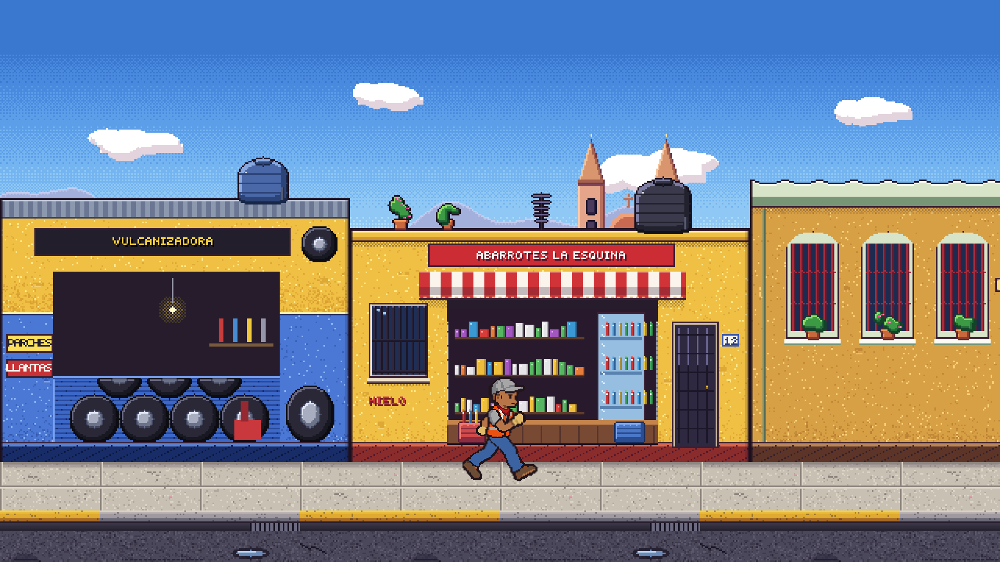

## Abrir el proyecto

1. Clona el repositorio.
2. En Unity Hub, entra a Projects > Add > Add project from disk y elige la carpeta clonada (la que contiene `Assets`, `Packages` y `ProjectSettings`).
3. Ábrelo con Unity 6000.5.9f1. Usa la plantilla Universal 2D (URP) y el Input System. La primera importación genera `Library` y tarda unos minutos.
4. Abre `Assets/Scenes/Calle.unity`, la escena principal y la primera de Build Settings, y presiona Play.

## Teclas

| Tecla | Qué hace |
|---|---|
| Flecha derecha o D | Correr, mirando a la derecha |
| Flecha izquierda o A | Correr, mirando a la izquierda |
| Ninguna, o las dos direcciones a la vez | Reposo, mirando hacia la última dirección |
| W o flecha arriba | Salta, sólo con los pies en el suelo (un salto por pulsación) |
| K (sostenida) | Apunta: la mira oscila delante del recolector |
| K (al soltar) | Lanza la bolsa hacia la mira (una por lanzamiento) |
| Barra espaciadora | Lanza la botella, recta hacia donde mira (una por pulsación) |

## La escena y el personaje (entrega 3.1)

- `Main Camera`: cámara ortográfica con Pixel Perfect Camera (URP 2D), 96 píxeles por unidad y resolución de referencia 1920x1080 (desde la entrega 3.2; antes 32 y 640x360). La vista mide 20 por 11.25 unidades: el escenario, a 32 píxeles por unidad, se dibuja a 3 píxeles de pantalla por píxel y el recolector y los proyectiles, a 48, a 2, los dos enteros. Encuadra las fachadas, la banqueta y un poco de asfalto. Desde la entrega 3.4 lleva además el script `CamaraSigue`.
- `Grid > Suelo`: Tilemap de la banqueta y el asfalto, con la paleta `Assets/Arte/Paleta/Calle.prefab` (Window > 2D > Tile Palette).
- `Calle`: el script `CalleModular` encadena las fachadas de `Assets/Arte/Escenario/Modulos/` en orden aleatorio con semilla fija, pinta el suelo y repite el cielo hasta cubrir lo que ve la cámara más un margen; lo que queda atrás se recicla. Con la cámara quieta sólo llena la vista; desde la entrega 3.4 la cámara sigue al recolector y la calle avanza con ella.
- `Recolector`: SpriteRenderer, Animator y `RecolectorControl`, de pie sobre la banqueta (desde la entrega 3.3, también Rigidbody2D y CapsuleCollider2D).

Los sprites del recolector salen de tiras de cuadros del mismo tamaño (`Assets/Arte/Recolector/`), cortadas en modo Multiple con el pivote en los pies y filtro Point. El controlador `Assets/Animaciones/Recolector.controller` tiene dos estados: Reposo (por defecto) y Correr, con transiciones en ambos sentidos sin Has Exit Time y el parámetro bool `corriendo`.

`Assets/Scripts/RecolectorControl.cs` lee el teclado con el Input System (`Keyboard.current`), pone `corriendo` en verdadero mientras hay una dirección pulsada y voltea al personaje con la escala en x.

Por ahora el personaje no se desplaza: cambia de animación y de orientación según la tecla, lanza la bolsa y la botella (entrega 3.2) y salta con la física 2D (entrega 3.3). La cámara lo sigue desde la entrega 3.4; el movimiento por la calle llega en la 3.5.

## Los prefabs (entrega 3.2)

Las balas de este juego son dos prefabs que salen de la misma base, el script `Proyectil`: la bolsa de basura, que se lanza apuntando, y la botella, el proyectil rápido. Los dos nacen en la mano del recolector, no en el centro del personaje, y salen hacia donde está mirando.

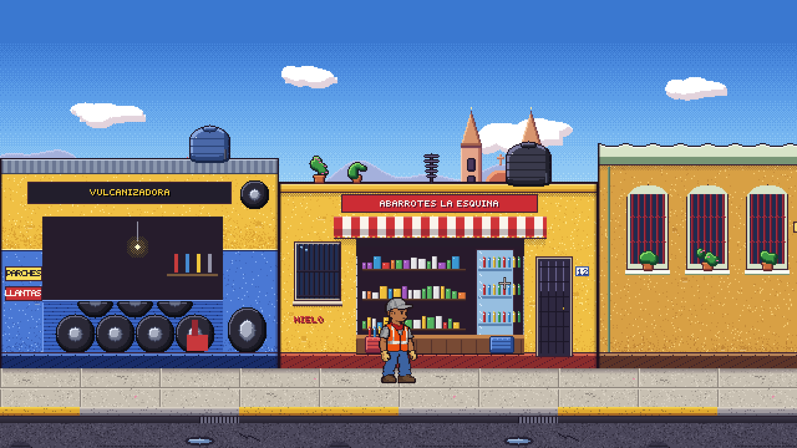

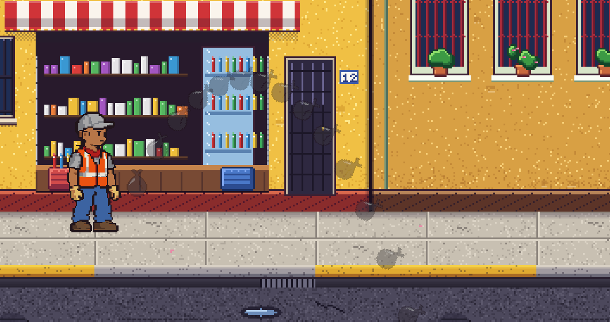

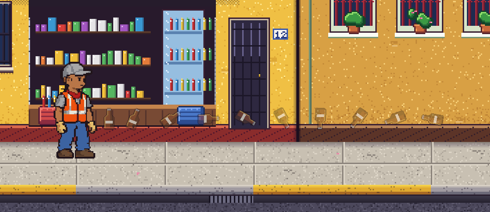

Las dos imágenes juntan varios cuadros del mismo lanzamiento: el arco de la bolsa con la mira alta y la línea recta de la botella. La de la bolsa es de la 3.2, antes del collider del suelo; su rebote está en la sección de la 3.3.

- `Assets/Scripts/Proyectil.cs`: la base común. Cada prefab trae su configuración (rapidez, escala de gravedad, vida, giro y cuántos contactos aguanta); `Lanzar(direccion, sentido)` fija la velocidad inicial y la velocidad angular del Rigidbody2D, y la física 2D hace el resto. El proyectil desaparece al salir del encuadre de la cámara o al cumplir su vida. Otro objeto que vuele es un prefab nuevo con otros números.
- `Assets/Prefabs/Bolsa.prefab`: sprite `bolsa.png` (24x24), Rigidbody2D con gravedad, CircleCollider2D (radio 0.19) con el material `Assets/Fisica/Bolsa.physicsMaterial2D` (restitución 0.5, fricción 0.4) y `Proyectil` a 7 unidades por segundo con giro de 200 grados por segundo. Se lanza como en Yoshi's Island: al sostener K aparece la mira (`Mira.cs`, hija del recolector), que oscila sola entre -10 y 70 grados delante de él, a 2.5 unidades de la mano, en ciclos de 1.2 segundos; al soltar K la bolsa sale hacia la mira y la gravedad la curva. Con la mira alta sube por encima de la cabeza y cae unas cuatro unidades adelante; con la mira baja es un tiro corto y tendido. En la 3.2 el suelo todavía no tenía collider, así que la bolsa atravesaba la banqueta, seguía cayendo y desaparecía al salir de la vista; conservó su collider, su material y dos rebotes configurados, y desde la 3.3 rebota en el suelo.
- `Assets/Prefabs/Botella.prefab`: sprite `botella.png` (12x24), Rigidbody2D sin gravedad (escala 0), CapsuleCollider2D y `Proyectil` a 14 unidades por segundo girando a 540 grados por segundo. Sale con la barra espaciadora, recta y horizontal hacia donde mira el recolector, y desaparece al salir de la vista o a los 3 segundos. Es la plantilla de cualquier otro proyectil rápido.
- `PuntoDisparo`: un objeto vacío, hijo del `Recolector`, a la altura de la mano (0.75 unidades por delante del centro y 0.9 sobre los pies); los dos proyectiles nacen ahí. Como es hijo, cuando el personaje se voltea con la escala en x el punto y la mira pasan al otro lado.
- `RecolectorControl.cs`: lee las dos teclas con el Input System (`wasPressedThisFrame` y `wasReleasedThisFrame`: un proyectil por pulsación), instancia el prefab en `PuntoDisparo` y le pasa la dirección: la de la mira para la bolsa, la horizontal hacia donde mira para la botella. Los proyectiles no chocan con el recolector ni entre sí (`Physics2D.IgnoreCollision`).

La cadencia del lanzamiento y los efectos del proyectil llegan en la 3.7 y la animación de lanzar en la 3.6. El collider del suelo y la física del recolector (gravedad, salto, colisiones) llegaron en la 3.3.

## Mecánicas y físicas (entrega 3.3)

El recolector ya tiene cuerpo físico: la gravedad lo baja, choca con la banqueta y salta con W o con la flecha arriba. El suelo tiene collider, así que la bolsa, que en la 3.2 atravesaba la banqueta, ahora rebota en ella.

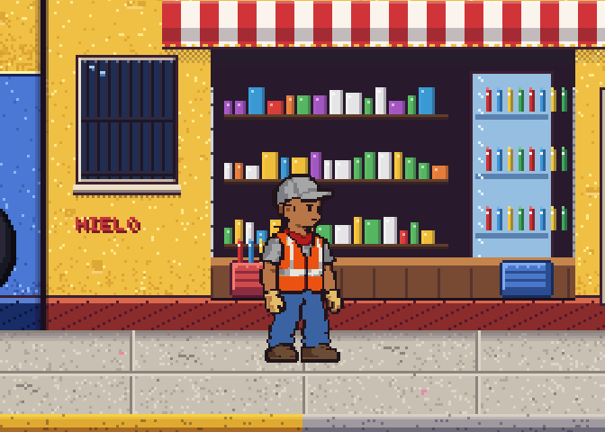

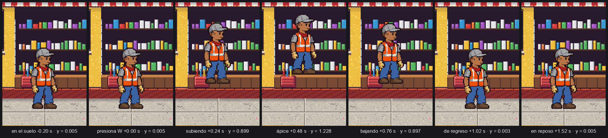

Cada cuadro lleva el tiempo desde que se presiona W y la altura de los pies. Con la flecha arriba el salto es el mismo.

- `Recolector`: Rigidbody2D dinámico (masa 1, escala de gravedad 1, rotación en Z congelada, interpolado y con detección continua) y CapsuleCollider2D vertical de 0.75 por 2.19 unidades, ajustada al cuerpo sin los brazos y con la base en los pies (y = 0).
- `Grid > Suelo`: TilemapCollider2D unido (Merge) en un CompositeCollider2D, con un Rigidbody2D estático, en la capa `Suelo` (capa de usuario 6). Los tiles usan el collider de la celda completa y el compuesto baja 0.375 unidades (12 píxeles del suelo) para que la superficie quede en la línea de los pies. Como `CalleModular` pinta el suelo conforme avanza la calle, el collider crece con ella.
- `RecolectorControl.cs`: en cada cuadro lanza un rayo hacia abajo (`Physics2D.Raycast`) desde el centro de la cápsula hasta 0.1 unidades por debajo de los pies, sólo contra la capa `Suelo`, para saber si está en el suelo; `Debug.DrawRay` lo dibuja en la vista de escena. Con W o la flecha arriba (`wasPressedThisFrame`) y los pies en el suelo, salta con `AddForce` hacia arriba en modo impulso: sale a 5 unidades por segundo, sube 1.22 unidades y vuelve a la banqueta en 1.02 segundos. En el aire, otra pulsación no hace nada.
- La bolsa rebota en la banqueta con su material (restitución 0.5), cada vez más bajo, y desaparece al tercer contacto; la botella vuela recta por encima del suelo. Ninguna de las dos choca con el recolector (`Physics2D.IgnoreCollision` con su cápsula).

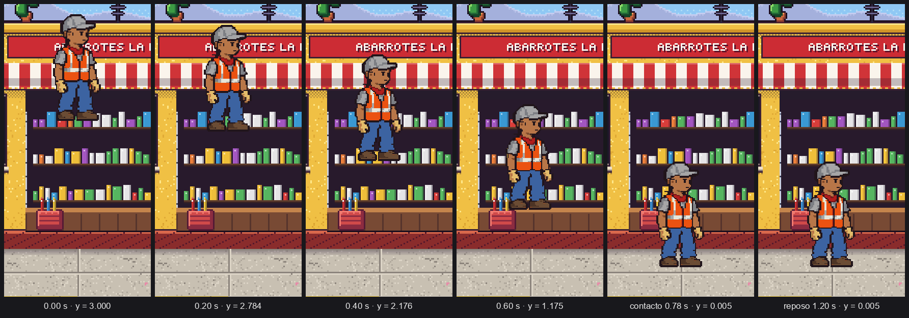

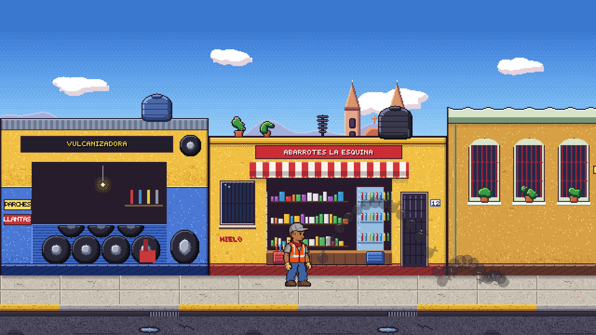

La cámara que sigue al recolector llegó en la 3.4 y el desplazamiento a los lados llega en la 3.5.

## La cámara (entrega 3.4)

La cámara sigue al recolector como en el tutorial (34:07): en cada cuadro toma su posición en x y deja la altura de la escena, así que al saltar no se mueve y el recolector sube en la pantalla. Con el recolector quieto la vista es la de la entrega 3.3, píxel por píxel. Moverse a los lados con el teclado llega en la 3.5, así que las imágenes salen de una prueba que le da velocidad al cuerpo del recolector desde código; en el editor se ve cambiando su posición en x en el Inspector durante Play, y la cámara aparece donde lo pongas.

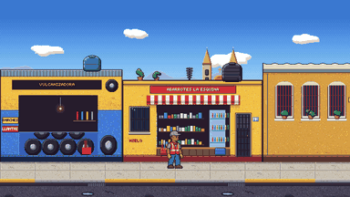

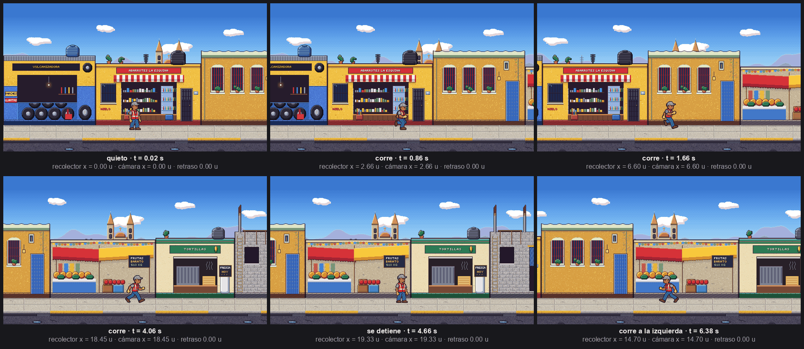

- `Assets/Scripts/CamaraSigue.cs`: el script de cámara del tutorial (34:07), con el recolector en lugar de John. En cada cuadro pone la x de la cámara igual a la de su objetivo y no toca la y ni la z, que son las de la escena. Corre en `LateUpdate` y antes que `CalleModular` (el tutorial usa `Update`): así lee la posición del recolector ya interpolada en ese cuadro y la calle se arma con ella. Si el objetivo desaparece (46:40), la cámara se queda donde está.
- `Main Camera`: sigue la Pixel Perfect Camera de la 3.2 (96 píxeles por unidad, referencia 1920x1080), que fija el tamaño (1080 / 2 / 96 = 5.625): una vista de 20 por 11.25 unidades donde el recolector ocupa el 19 % de la altura y, con su salto, el 30 %. El tutorial baja `Size` a mano (8:07); aquí no se toca, y la última figura compara esta distancia con una al doble y otra a la mitad.
- Sin retraso: en un recorrido de x = -29.5 a x = 29.5 y de regreso a 4.9 unidades por segundo (1 920 cuadros), la cámara tuvo la x del recolector en todos los cuadros, también al detenerse y a 30, 60 y 144 cuadros por segundo.
- Sin temblor: la Pixel Perfect Camera dibuja la cámara y cada sprite en el píxel más cercano a su posición; con la misma x caen en el mismo y el recolector no se mueve en la pantalla (su columna en la imagen no cambió ni una vez en los 720 cuadros que mide la prueba, a ocho velocidades y en los dos sentidos).
- `Calle`: `CalleModular` ya leía la posición de la cámara. En ese recorrido la vista tuvo fachadas, suelo y cielo en todos los cuadros, la calle no pasó de 7 piezas de fachada ni de 6 columnas de suelo, y al volver están las mismas fachadas en el mismo lugar. La botella sigue desapareciendo al salir de la vista (con la cámara en x = 24, a 10.8 unidades de ella).

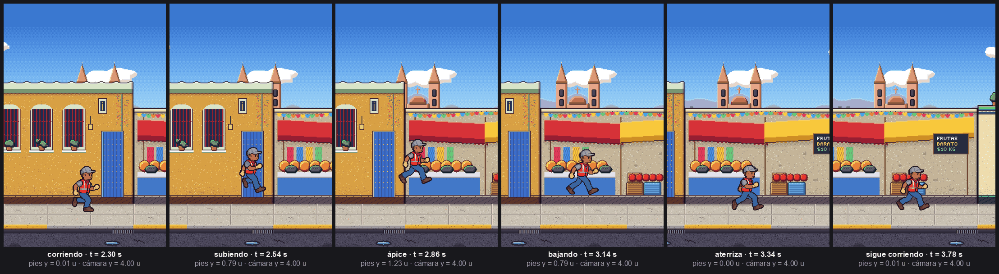

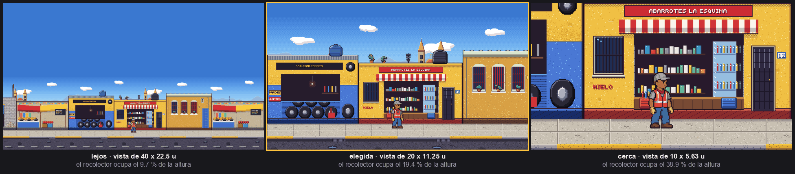

Al doble de distancia el recolector se pierde bajo un cielo vacío y la calle queda en una franja; a la mitad no cabe ni una fachada entera y su salto ocupa más de la mitad de la altura.

## Arte

Todo el arte es original y está hecho para este proyecto. El recolector es pixel art de 128x128 por cuadro, editado en Aseprite: 8 cuadros de reposo y 12 de carrera, con los pies en la misma línea en todos los cuadros; se importa a 48 píxeles por unidad para quedar en proporción con las fachadas. La bolsa (24x24), la botella (12x24) y la mira (15x15) son sprites hechos pixel por pixel con colores de la paleta del recolector. Las fachadas, el suelo, el cielo, el camión, el perro y la moneda de peso son pixel art hecho con código, sin recursos descargados.

## Qué se versiona

`Assets`, `Packages` y `ProjectSettings`, con sus archivos `.meta`. `Library`, `Temp`, `Logs`, `UserSettings` y las compilaciones quedan fuera por el `.gitignore`.
